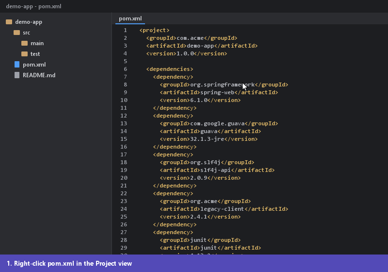
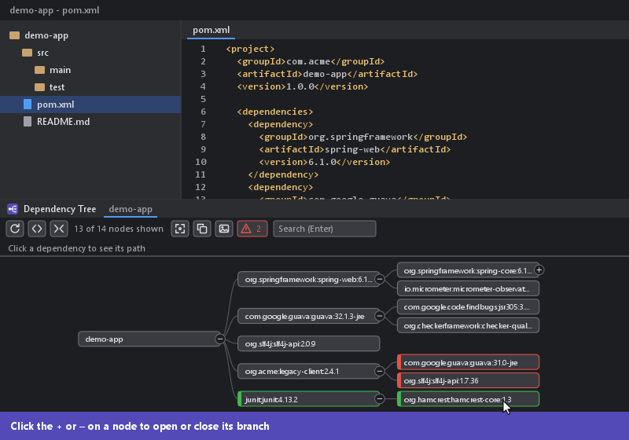
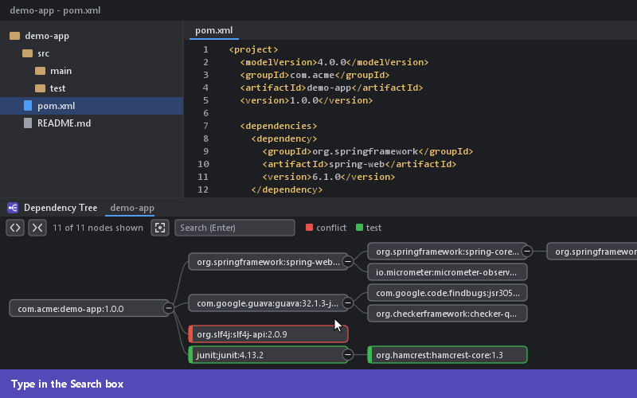
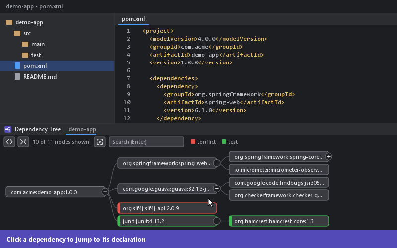
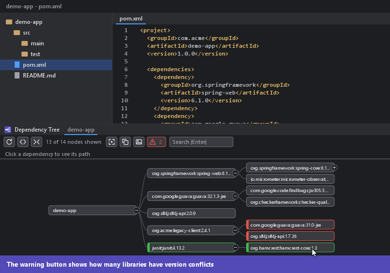
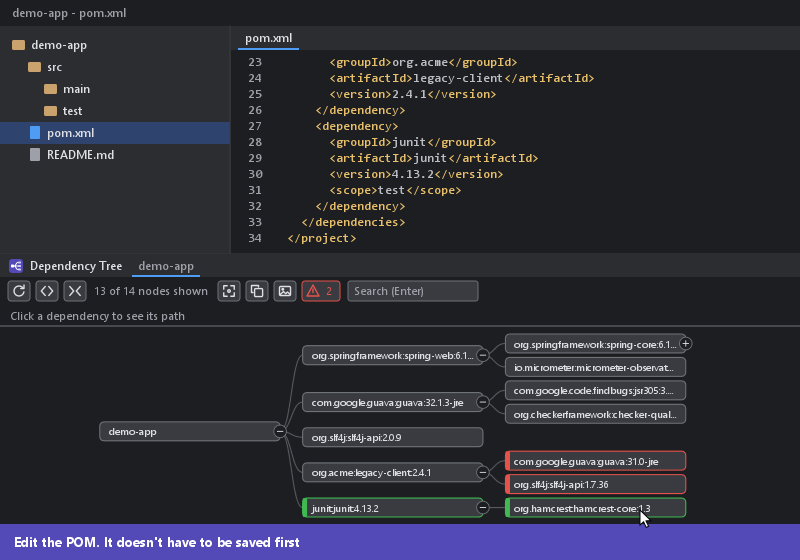
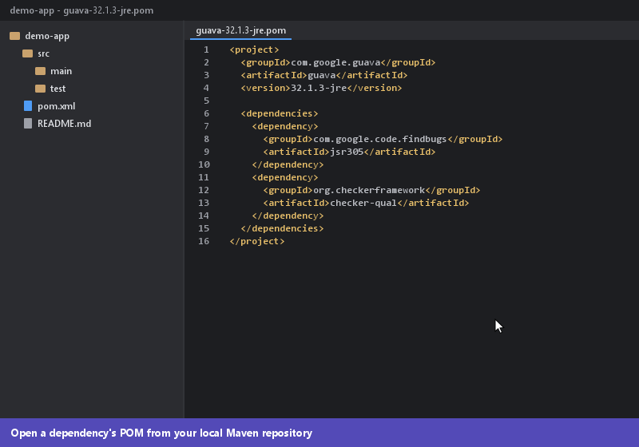

# Maven Dependency Tree Graph

A free IntelliJ IDEA plugin that shows a Maven project's dependencies as an interactive, collapsible graph. Right-click a `pom.xml` to see the full tree, spot version conflicts, and jump straight to where a dependency is declared.

> The animations in this README are illustrations of the workflow, not recordings. The real IDE window will look a little different.

## Features

- **Graphical tree:** see direct and transitive dependencies as a left-to-right graph, with one tab per POM.
- **Expand and collapse:** open branches one at a time, or expand and collapse the whole tree in one click.
- **Search:** highlight every matching dependency, open the branches they're in, and see how many matched.
- **Jump to the POM:** click a node to open the place it's declared.
- **Path bar:** see how a dependency got into your project, and click any step to go there.
- **Version conflicts:** see which version was used, which were omitted, and what requested them.
- **Copy and export:** copy the tree as text or save it as a PNG, whole or just what's expanded.
- **Reload from POM:** save your edits, sync Maven, and redraw the graph in one click.
- **Repository POMs:** open the tree of a dependency's `.pom` file from your local Maven repository.
- **Colour coding:** conflicts, duplicates and omitted dependencies, test scope, and provided or runtime scope are all marked.
- **Fit, pan and zoom:** fit the graph to the window, drag to move around, and use the mouse wheel to zoom.
- **Light and dark themes:** the graph follows your IDE theme.

## Requirements

- IntelliJ IDEA 2021.3 or newer, with the bundled Maven plugin enabled
- A `pom.xml` imported as a Maven project

## Usage

### Open the tree

### Search

### Jump to the POM

### See version conflicts

### Copy as text and export as an image

### Reload from the POM

### Open a dependency's POM

## License

Free to use under the [MIT License](LICENSE). Copyright (c) 2026 Dushmantha Bandaranayake.
